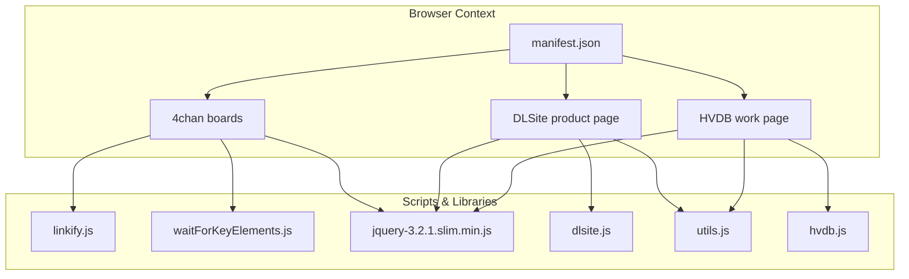

# Developer Agent Guide: DLRJ

Welcome! This guide is written for AI agents and developer tools to quickly get up to speed with the **DLRJ** repository, which is a Chromium extension designed to enhance user convenience when browsing DLSite, HVDB, and 4chan.

---

## 📂 Codebase File Map

The repository is structured as a standard Chrome/Chromium Extension (Manifest V3).

- [manifest.json](file:///home/ionasal/src/dlrj/manifest.json) — Extension entry point, metadata, and script registration.
- [utils.js](file:///home/ionasal/src/dlrj/utils.js) — Shared utility functions for generating URLs, extracting page titles, and creating top navigation bars.
- [dlsite.js](file:///home/ionasal/src/dlrj/dlsite.js) — Content script running on DLSite product pages.
- [hvdb.js](file:///home/ionasal/src/dlrj/hvdb.js) — Content script running on HVDB work details pages.
- [linkify.js](file:///home/ionasal/src/dlrj/linkify.js) — Content script running on 4chan board pages to parse and linkify RJ-codes.
- [waitForKeyElements.js](file:///home/ionasal/src/dlrj/waitForKeyElements.js) — Utility function to wait for asynchronously-loaded DOM elements (specifically post messages on 4chan).
- [jquery-3.2.1.slim.min.js](file:///home/ionasal/src/dlrj/jquery-3.2.1.slim.min.js) — Local jQuery slim dependency used across all content scripts.
- [README.md](file:///home/ionasal/src/dlrj/README.md) — Basic installation instructions.
- [NEWS.md](file:///home/ionasal/src/dlrj/NEWS.md) — Release notes and project changelog.

---

## 🛠️ Architecture and Data Flow

### 1. 4chan Linkification (`linkify.js`)
- Runs on: `*://boards.4chan.org/*` and `*://boards.4channel.org/*`
- Uses [waitForKeyElements](file:///home/ionasal/src/dlrj/waitForKeyElements.js#L18-L92) to match post blocks: `blockquote.postMessage`.
- Calls [linkifyRJ](file:///home/ionasal/src/dlrj/linkify.js#L6-L10) to search for RJ-codes (format: `RJ` followed by 6 to 8 digits) and replace them with a hyperlink pointing to DLSite.

### 2. DLSite Product Pages (`dlsite.js`)
- Runs on: `*://www.dlsite.com/maniax/*/=/product_id/*`
- Extracts the RJ-code from the page URL using regex matching.
- Retrieves the title using [getDLSiteWorkTitle](file:///home/ionasal/src/dlrj/utils.js#L35-L38).
- Prepends a gray information/link bar to the top of the body with [addLinkbarWithNyaa](file:///home/ionasal/src/dlrj/utils.js#L29-L33).

### 3. HVDB Work Details Pages (`hvdb.js`)
- Runs on: `*://hvdb.me/Dashboard/WorkDetails/*`
- Extracts the code from the URL and normalizes it (ensures `RJ` prefix and zero-pads short numerical IDs to standard 6 or 8 digit format).
- Retrieves the title using [getHVDBWorkTitle](file:///home/ionasal/src/dlrj/utils.js#L40-L42).
- Prepends the standard linkbar using [addLinkbarWithNyaa](file:///home/ionasal/src/dlrj/utils.js#L29-L33).

---

## 🏷️ Key Functions and APIs

### URL Generator Utilities
- [DLSiteWorkURL(rjcode)](file:///home/ionasal/src/dlrj/utils.js#L1-L3): Returns the DLSite product page URL.
- [DLSiteAnnounceURL(rjcode)](file:///home/ionasal/src/dlrj/utils.js#L5-L7): Returns the DLSite announcement URL.
- [hvdbURL(code)](file:///home/ionasal/src/dlrj/utils.js#L9-L11): Returns the HVDB page URL.
- [asmrURL(rjcode)](file:///home/ionasal/src/dlrj/utils.js#L13-L15): Returns the ASMR.one URL.

### DOM Manipulation Utilities
- [addLinkbar(rjcode, extra='')](file:///home/ionasal/src/dlrj/utils.js#L17-L27): Inject the HTML toolbar containing links to DLSite, DLSite Announce, HVDB, and ASMR.one at the top of the page.
- [addLinkbarWithNyaa(rjcode, title)](file:///home/ionasal/src/dlrj/utils.js#L29-L33): Appends a Nyaa Sukebei search link using the work title to the standard linkbar.

---

## 💡 Developer Guidelines for Agents

When implementing modifications or resolving bugs in this repository, observe the following rules:

### 1. Match Pattern and URL Handling
- DLSite and HVDB page structures or URL formats can change. If links do not render, inspect selectors in [getDLSiteWorkTitle](file:///home/ionasal/src/dlrj/utils.js#L35-L38) or [getHVDBWorkTitle](file:///home/ionasal/src/dlrj/utils.js#L40-L42).
- Ensure any RJ-code extraction regex (e.g., in [dlsite.js](file:///home/ionasal/src/dlrj/dlsite.js) or [hvdb.js](file:///home/ionasal/src/dlrj/hvdb.js)) accommodates different lengths (e.g. 6-digit and 8-digit RJ-codes).

### 2. Chrome Extension Configuration
- The extension uses `manifest_version: 3`. Ensure no deprecated MV2 features (like inline scripts or forbidden content security policies) are introduced in updates.
- Check [manifest.json](file:///home/ionasal/src/dlrj/manifest.json) script arrays. Content scripts share global scopes on the page if grouped in the same entry of `"js"`. Note the ordering: `jquery` must load before scripts that depend on it.

### 3. Adding New Platforms or Targets
If you need to add support for another database or website:
1. Define a URL generation helper in [utils.js](file:///home/ionasal/src/dlrj/utils.js).
2. Update [addLinkbar](file:///home/ionasal/src/dlrj/utils.js#L17-L27) to incorporate the new platform link.
3. If creating a new content script, register it in the `"content_scripts"` array of [manifest.json](file:///home/ionasal/src/dlrj/manifest.json) under `"js"`, ensuring `jquery` and `utils.js` are loaded first.
